# boltbook

**Every bolt, every pattern, in one book.**

A self-hosted fabric-stash and sewing-pattern library: catalogue the fabric, patterns, thread,
notions and tools you already own, keep the details that matter — yardage, fibre, colour, size
range, what you have made from it — and find what you have when a new project starts.

Local-first, no account, runs on your own box. Mobile-first: designed for the phone at the shelf.

## Screenshots

| | | |
|---|---|---|
| 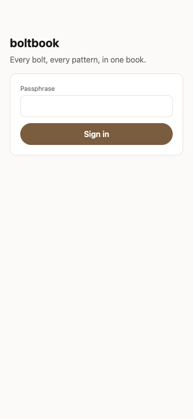 | 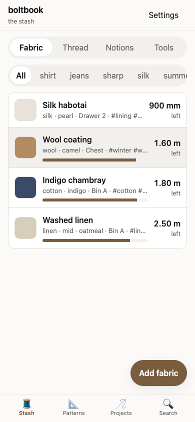 | 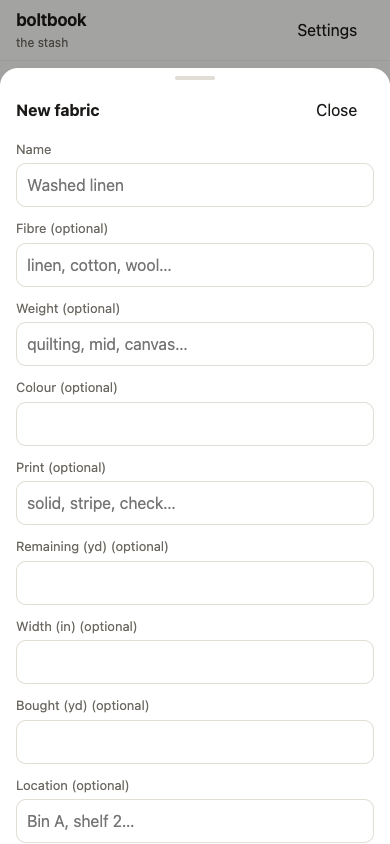 |
| **Sign in** — one person, one passphrase | **The stash** — remaining yardage at a glance | **Adding a fabric** — camera-first, every field skippable |
| 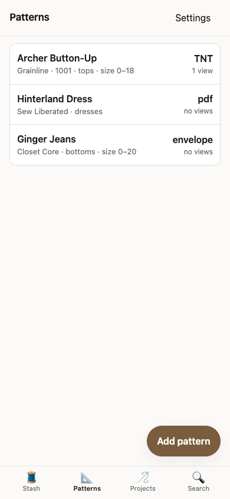 | 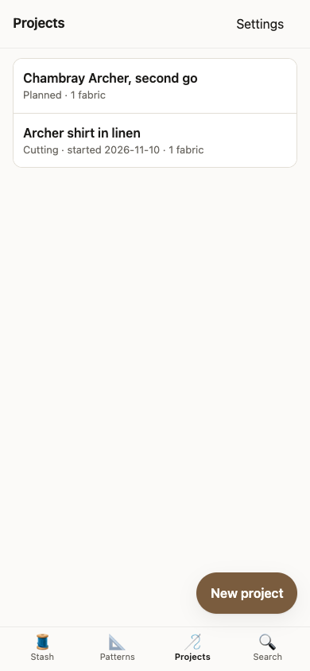 | 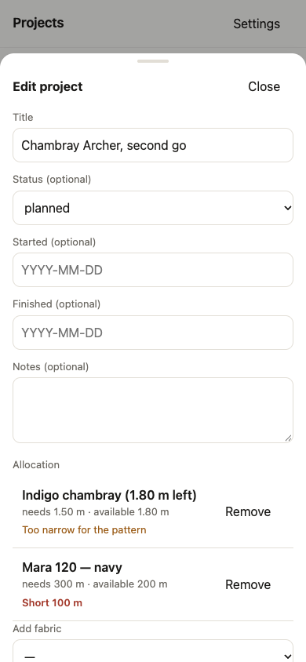 |
| **Patterns** — the library you already own | **Projects** — what you are making | **Allocation** — shortfalls and too-narrow fabric, named before you cut |
| 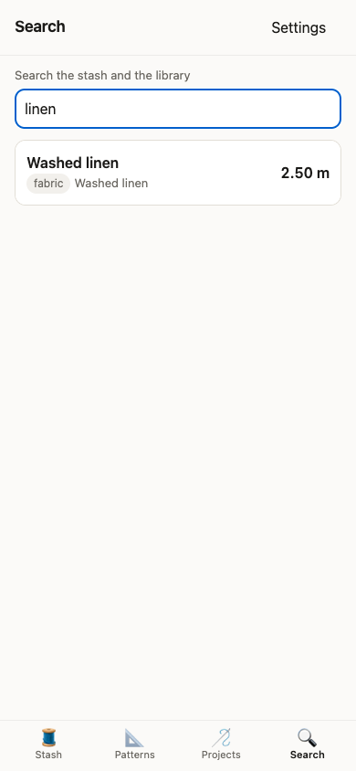 | 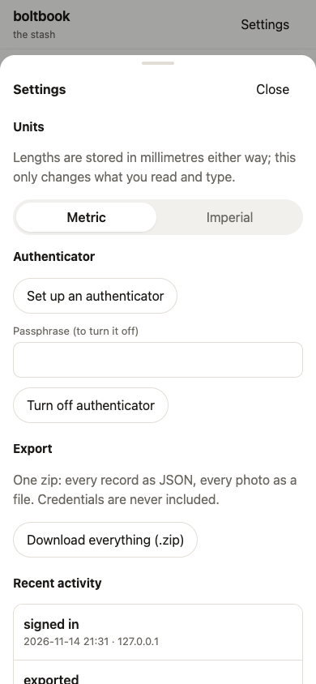 | 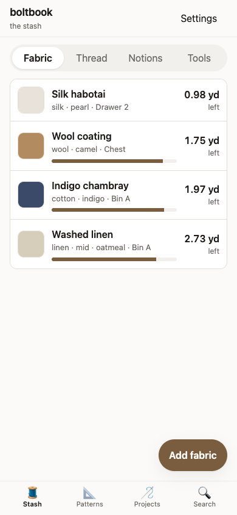 |
| **Search** — across fabric, patterns, thread and tools | **Settings** — units, authenticator, activity | **Imperial** — lengths read in yards and inches |
| 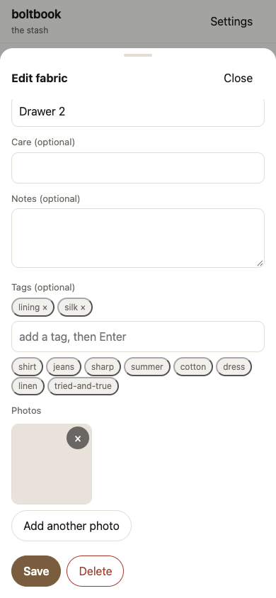 | 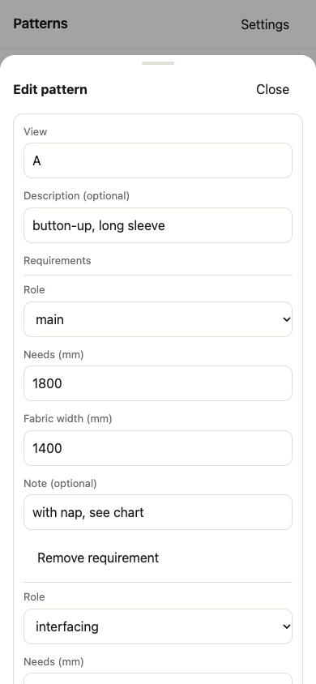 | 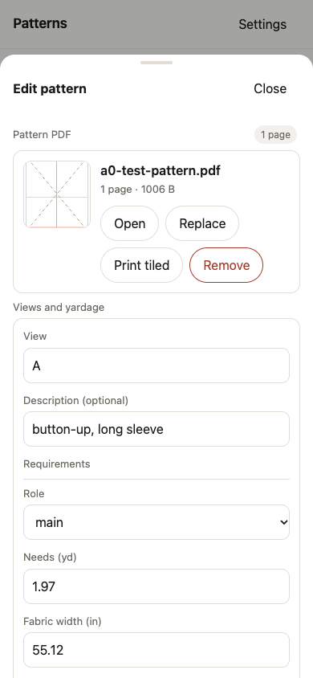 |
| **Tagging** — one vocabulary, offered as chips | **Views and yardage** — what each view of a pattern takes | **Pattern PDF** — the file belongs to the pattern, with its page count and preview |
| 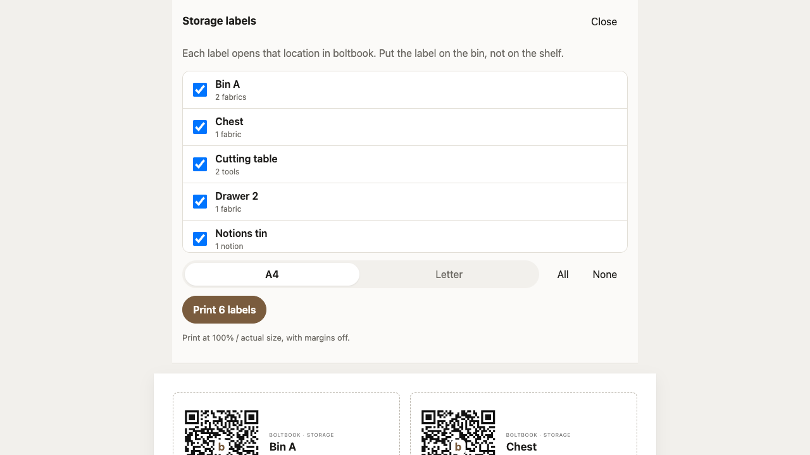 | 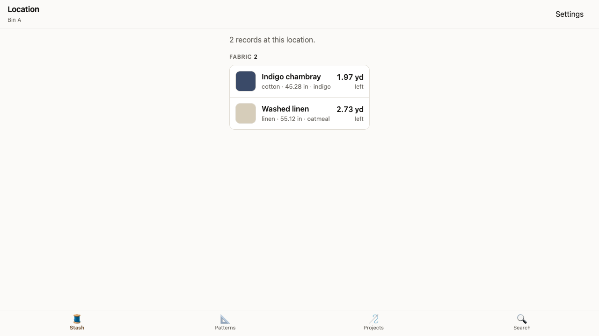 | 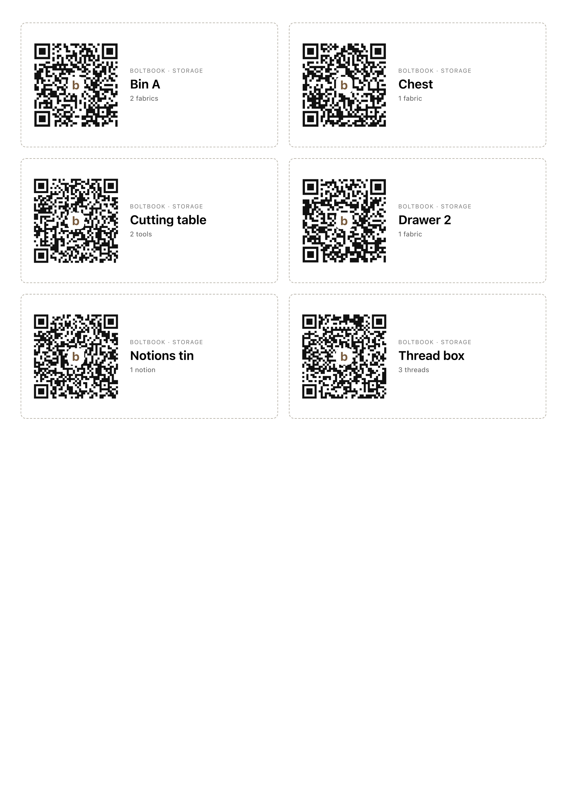 |
| **Labels** — one QR per storage location, with what is in it | **Location** — a scanned label opens every record in that bin | **Labels, printed** — 2 × 5 on A4 or Letter, at 100% |
| 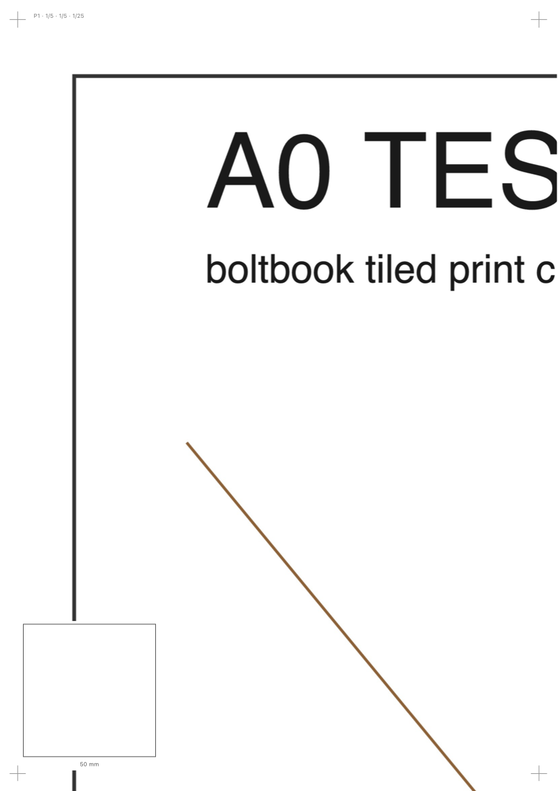 | 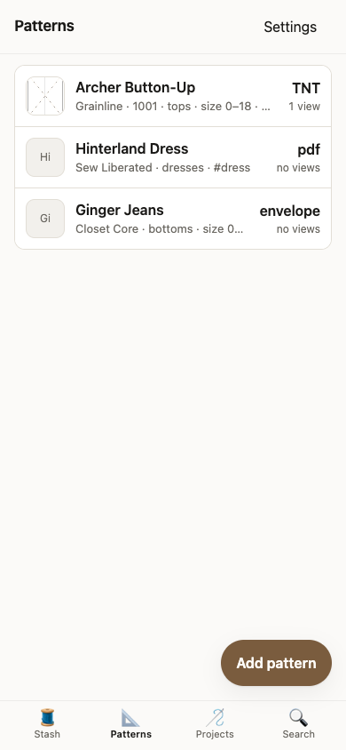 | |
| **Tiled print** — a pattern at full size, marks and a 50 mm check | **Patterns on a phone** — the thumbnail says a PDF is attached | |

## Where it fits

`boltbook` is the companion to [dressform](https://github.com/therebelrobot/dressform), and they
do different jobs:

| | job |
|---|---|
| **dressform** | draft and design a pattern — 2D flat sheet, emitted FreeSewing source, 3D drape and fit |
| **boltbook** (this) | keep what you already own — the stash and the pattern library |

boltbook is **not** a drafting tool. It never draws a piece or drafts a garment. It records the
fabric on the shelf and the patterns in the box, and answers the question a project starts with:
*do I already have this?*

## What it does

- **Fabric** — fibre, weight, colour, print, yardage (remaining and bought), width, source, care,
  location, photos. A bolt splits as you use it, and the yardage comes off it when a project is
  finished.
- **Patterns** — brand, number, format, size range, difficulty, category, plus **views**, each
  with its own yardage requirements and notions — all editable in the client.
- **Pattern PDFs** — the pattern owns its PDF (25 MB cap) with a page count and a first-page
  thumbnail; open it in a tab, export it with the records, or **print it tiled** across A4 or
  Letter at 100% with overlap, registration marks and a 50 mm scale check.
- **Storage labels** — a printable sheet of QR labels, one per location. Scanning one opens a
  location screen listing every fabric, thread, notion and tool in that bin.
- **Tags** — one vocabulary shared by every record, filterable, and searchable.
- **Thread** and **tools** as first-class records — thread with brand, colour code, fibre, spools
  and metres left; tools with a category and a needs-attention flag.
- **Notions** — buttons, zippers, interfacing, elastic, trims.
- **Projects** — allocate fabric, thread and notions to a pattern view, and the **shortfall**
  readout names what is short (remaining minus what other live projects reserve) and what is too
  narrow, before you cut.
- **Search** across everything, ranked.

## Units

**Storage is metric** — integer millimetres, metres — and nothing is lossy. The interface shows
and accepts either metric or imperial (fabric in yards, width in inches, thread in yards), chosen
in Settings and remembered on the device; the default follows the browser locale.

Scripts can do the same over the API: `?units=imperial` renames each measure to its unit-suffixed
form (`lengthMm` → `lengthYd`, `widthMm` → `widthIn`) and converts it, and writes accept those
names back. See `docs/technical-design.md` §5.

## Print

- **Storage labels** — **Settings → Print storage labels**. Choose the locations, A4 or Letter,
  and print at **100% / actual size** with margins off. Each label is 88 × 46 mm; the QR opens that
  location in boltbook.
- **A pattern at full size** — open the pattern → **Pattern PDF** → **Print tiled**. Choose A4 or
  Letter, 200–400 dpi and the overlap, then print at **100% / actual size** with margins off. The
  sheets overlap by 10 mm by default; the corner marks line up when taped in order, and the first
  sheet carries a 50 mm scale-check square.

## Run it

**Docker (the intended way):**

```sh
git clone https://github.com/therebelrobot/boltbook.git
cd boltbook
cp compose.yaml compose.override.yaml     # your hostname, port and setup token
docker compose up -d
docker compose logs boltbook              # prints the setup token on first start
```

Or, without Compose:

```sh
npm run docker:build
npm run docker:run
```

**From source:**

```sh
npm install
npm run build
BOLTBOOK_SETUP_TOKEN=pick-something npm start   # prints the token, then claim it in the browser
```

The server serves the built client and the API on one port. Without `BOLTBOOK_SETUP_TOKEN` it
generates one and prints it; the token is only used to claim the instance the first time.

To try it with demo data:

```sh
BOLTBOOK_URL=http://127.0.0.1:8080 BOLTBOOK_SETUP_TOKEN=<token> \
BOLTBOOK_PASSPHRASE='at least twelve characters' node --import tsx scripts/seed-demo.ts
```

Configuration is environment-only; every variable is in
[`docs/deployment.md`](docs/deployment.md), along with the reverse-proxy shape, backups and
upgrades. The short version: `BOLTBOOK_DATA_DIR`, `BOLTBOOK_DB`, `BOLTBOOK_PORT`, `BOLTBOOK_HOST`,
`BOLTBOOK_COOKIE_SECURE`, `BOLTBOOK_TRUST_PROXY`, `BOLTBOOK_PUBLIC_ORIGIN`,
`BOLTBOOK_SESSION_IDLE_MINUTES`, `BOLTBOOK_SESSION_MAX_HOURS`, `BOLTBOOK_SETUP_TOKEN`.

**Lost the passphrase?** There is no recovery code — nothing is encrypted, so there is no key to
recover. `npm run reset-passphrase -- --yes` clears the account (your records are untouched),
then claim the instance again with the setup token.

## Export and backup

- **Settings → Export**, or `GET /api/export`, gives one zip: `boltbook.json` with every record,
  `photos/` with the image files, and `pattern-files/` with the owned pattern PDFs and their
  thumbnails. Credentials are never in it.
- **Settings → Restore**, or `POST /api/import?mode=replace`, puts an export back. It replaces
  every record — tags, views, photos and pattern PDFs included — so take an export first if you
  are unsure. Your account and this instance's audit log are left alone.
- `npm run backup -- ./backups` settles the write-ahead log and copies `boltbook.db`. The copy is
  plaintext by design, so any SQLite tool can read it.

## Status

**v1 complete — M1–M7. v2a built — pattern PDFs, storage labels and tiled printing.** The
backend, the client, and shipping are all real:

- **Server** — fabrics (with photos), patterns with views, requirements and an owned PDF, notions,
  thread and tools, tags, projects with allocation and the shortfall rule, FTS5 search across the
  four indexed entities (plus a pass over the tags), distinct storage locations for the label
  sheet, single-user auth in the house model, an audit log, and a one-zip export.
- **Client** — React + Vite, mobile-first: bottom navigation, camera-first fabric capture with
  client-side downscale and EXIF stripping, drag-to-dismiss sheets, delete with undo, the yardage
  meter, tags, the pattern views/requirements editor, a per-device metric/imperial choice, the
  pattern PDF card with a client-rendered thumbnail, the location screen, the QR label sheet, and
  the tiled print preview. All verified in a real browser (the screenshots above), at desktop and
  phone widths; an A0 fixture prints to 25 A4 pages with the 50 mm check, and a printed label QR
  decodes back to its location URL.
- **Ship** — a multi-stage Docker image with no `node_modules` in the runtime layer, `compose.yaml`,
  CI that typechecks/builds/tests and builds both architectures, and a GHCR publish workflow with
  provenance and an SBOM. The image was built and run: it serves the client, claims, persists to a
  volume, reports healthy, and survives a restart.

162 tests, `tsc` clean, `npm audit` clean on Node 26 LTS.

**Not yet:** the rest of v2 — shopping list, tag hygiene, project photos, costing, imports and
envelope OCR. See [`docs/v2-plan.md`](docs/v2-plan.md).

## Docs

| Document | Owns |
|---|---|
| `docs/product-brief.md` | why this exists, the scope, v1 vs v2 |
| `docs/technical-design.md` | modules, the data model, the seams, the plan |
| `docs/design-brief.md` | how the client looks, moves and feels |
| `docs/deployment.md` | running it, the environment, proxies, backups, upgrades |
| `docs/v2-plan.md` | what comes after v1: scoped, costed, ordered |
| `docs/adr/0001-no-encryption-at-rest.md` | the decision, and what it costs |

## License

[Unlicense](LICENSE) — public domain.
